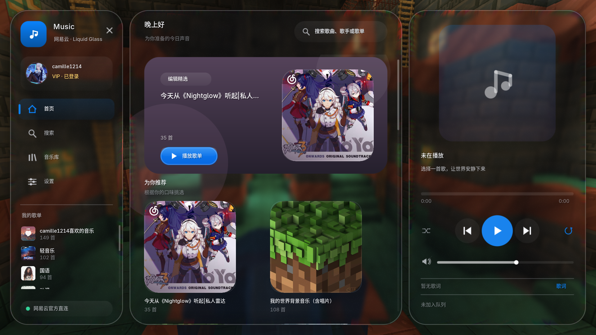

# iOS Music

一个运行在 **Minecraft 1.21.1 + NeoForge** 的网易云音乐客户端播放器。全部逻辑在客户端完成，不需要服务端安装。

界面以 WWDC25 公布的 Liquid Glass 语言为灵感：内置 Inter / Noto Sans SC 字体；每块玻璃面板单独捕获身后的场景，用中分辨率源做 5×5 高斯核模糊，再做边缘折射与 RGB 色散。面板本身不绘制漆面高光；面板外不进行任何模糊或遮罩。

## 界面预览



## 功能

- **双后端**
  - **官方接口直连**：请求 `music.163.com`，使用与网页端一致的 weapi 加密；支持匿名浏览、二维码登录、手机号密码登录和浏览器 Cookie 登录。
  - **第三方 API**：兼容 [NeteaseCloudMusicApi](https://github.com/Binaryify/NeteaseCloudMusicApi) 及常见衍生部署；在设置里填写地址，例如 `http://127.0.0.1:3000`。
- **发现 / 搜索 / 歌单**
  - 首页推荐、排行榜、新歌速递、每日推荐。
  - 歌曲、歌手、歌单搜索。
  - 完整歌单页、歌曲列表、播放全部/随机播放。
- **播放**
  - MP3 流式播放，首次播放自动缓存，之后可离线重播。
  - 播放队列、上一首/下一首、随机、列表循环、单曲循环。
  - 进度拖动、音量、同步歌词、全屏歌词页。
  - 会员/版权歌曲可能只返回试听片段，界面会提示。
- **玻璃与排版**
  - 内置 Inter（拉丁）与 Noto Sans SC（简体中文），常用汉字完整覆盖，生僻字回退 unifont。
  - 玻璃面板内部使用 5×5 高斯核模糊，面板外保持原始清晰，不做全屏模糊。
  - 双 FBO：全分辨率纹理用于边缘折射，中分辨率纹理用于高斯模糊；边缘有透镜位移和 RGB 色散。
  - 无白色高光、斜向反光或指针光斑；只用模糊、折射、细边框和投影定义材质。
  - 透明度（0–90）与玻璃模糊（0–10）实时调节；深色外观、6 种强调色。
  - 侧栏、内容页、右侧播放面板带缓动进入动画；页面切换和滚动都有平滑过渡。
- **悬浮迷你播放器**
  - 圆形专辑封面；线性过滤 + 高分辨率缓存，减少边缘锯齿。
  - 第二行显示当前歌词（可关闭），宽度随歌名/歌词长度平滑变化。
  - 有翻译时在歌词下方显示一行翻译；岛的高度随翻译行平滑变化。
  - 播放暂停/缓冲时不显示歌词行，只保留歌名/歌手。
  - 透明度、模糊、上下位置都可调，默认下移避开 Jade 等顶部信息。
  - 可整体关闭。
- **一起听**
  - 服务器安装同一版本的 iOS Music 后，客户端会自动上报并列出同服安装了模组的玩家。
  - 可向其中一名玩家发送邀请，对方接受后进入 2 人房间。
  - 房主播放/暂停/切歌/进度会同步给客人；客人自动跟随。
  - 服务端组件可选；未安装时客户端仍可正常单人使用，只是没有一起听列表。
- **账号**
  - 扫码登录（二维码由 ZXing 本地生成）。
  - 手机号 + 密码登录。
  - 浏览器 Cookie 登录。
  - 登录状态本地保存。

## 玻璃合成管线

Minecraft 没有公开 Apple 系统合成器那种材质 API，所以模组自带了一套屏幕空间玻璃合成器：

- `GlassSnapshot`：每帧把场景复制到全分辨率与中分辨率 FBO；中分辨率纹理由以下着色器取样。
- `glass.fsh`：用 5×5 高斯核（双线性过滤）取样中分辨率纹理，再做透镜位移与 RGB 色散。
- `GlassShader`：解析抗锯齿的圆角、胶囊线、三角形、圆环和圆弧，供图标与控件共用。
- `Glass`：面板/按钮/进度条等组件层，统一处理阴影与透明度；不绘制漆面高光。

## 环境

| 项目 | 版本 |
| --- | --- |
| Minecraft | 1.21.1 |
| NeoForge | 21.1.x（测试使用 21.1.233） |
| Java | 21 |
| 测试实例 | `E:\.minecraft\versions\Create+` |
| JDK | `E:\java\java21` |

## 安装

把构建好的：

```
build/libs/iosmusic-1.0.0.jar
```

复制到：

```
E:\.minecraft\versions\Create+\mods\iosmusic-1.0.0.jar
```

启动游戏即可。本模组是客户端模组，不需要安装在服务器。

## 快捷键

| 快捷键 | 作用 |
| --- | --- |
| `O` | 打开/关闭播放器（标题界面和游戏内均可） |
| `O` | 打开/关闭播放器界面 |
| `P` | 播放/暂停 |
| `]` | 下一首 |
| `[` | 上一首 |
| `J` | 一起听页面 |
| `P` | 播放/暂停 |
| `[` | 上一首 |
| `]` | 下一首 |
| `L` | 打开/关闭歌词页（播放器内） |
| `Ctrl + F` | 聚焦搜索框 |
| `Esc` | 关闭弹窗 / 关闭播放器 |

所有按键都可以在 Minecraft 的“选项 → 控制 → 按键绑定”中修改。

## 设置

播放器内的“设置”页可以调整：

- 玻璃透明度、玻璃模糊
- 悬浮播放器开关
- 悬浮播放器歌词开关
- 悬浮播放器上下位置（负值上移，正值下移）
- 悬浮播放器透明度、悬浮播放器模糊
- 减少动态效果
- 强调色

## 官方接口

默认 `AUTO` 模式会先尝试本机第三方 API；若没有检测到，则使用官方直连。官方接口可能触发网易云风控；可在设置里切换到第三方 API，或使用 Cookie 登录。

## 第三方 API

在设置中把 API 模式切到 `THIRD_PARTY`，填写服务地址，例如：

```
http://127.0.0.1:3000
```

需要服务端允许跨域/本机访问；常见部署方式见 [NeteaseCloudMusicApi](https://github.com/Binaryify/NeteaseCloudMusicApi)。

## 构建

需要 JDK 21。构建脚本使用本地 `E:\.minecraft` 中的 NeoForge 依赖：

```powershell
powershell.exe -NoProfile -ExecutionPolicy Bypass -File .\build.ps1 -Deploy
```

产物：`build/libs/iosmusic-1.0.0.jar`。

Forge 1.21.1（Forge 52.1.19）单独构建：

```powershell
powershell.exe -NoProfile -ExecutionPolicy Bypass -File .\build-forge.ps1
```

Forge 产物：`build/forge/libs/iosmusic-1.0.0-forge.jar`，不会覆盖 NeoForge 版。Forge 版包含播放器、玻璃界面、灵动岛和外观设置；一起听联机通道暂未接入 Forge 网络层。

Fabric 1.21.1 单独构建（需要 Fabric Loader 与 Fabric API）：

```powershell
cd fabric1211
.\gradlew.bat build
```

Fabric 产物：`fabric1211/build/libs/iosmusic-fabric-1.21.1-1.0.0.jar`。

1.20.1 Forge 版：

```powershell
cd forge1201
.\gradlew.bat build
```

产物：`forge1201/build/libs/iosmusic-forge-1.20.1-1.0.0.jar`。1.20.1 为独立基础移植版，部分自定义半透明绘制仍在适配中。

## 已知限制

- 官方接口可能被风控；第三方 API 更稳定。
- 部分 VIP/版权歌曲只返回试听片段。
- 玻璃折射是屏幕空间近似，不是 Apple 系统合成器本身；不同光影/渲染模组下效果可能有差异。
- 高斯模糊先降采样到中等分辨率，再用 5×5 高斯核采样；模糊值越高，降采样倍率越大。
- 悬浮播放器显示当前歌词 + 翻译；完整歌词请打开歌词页。

## 许可

代码以 MIT 许可发布。内置字体与 ZXing 的许可见 `src/main/resources/META-INF/THIRD_PARTY_NOTICES.txt`。
